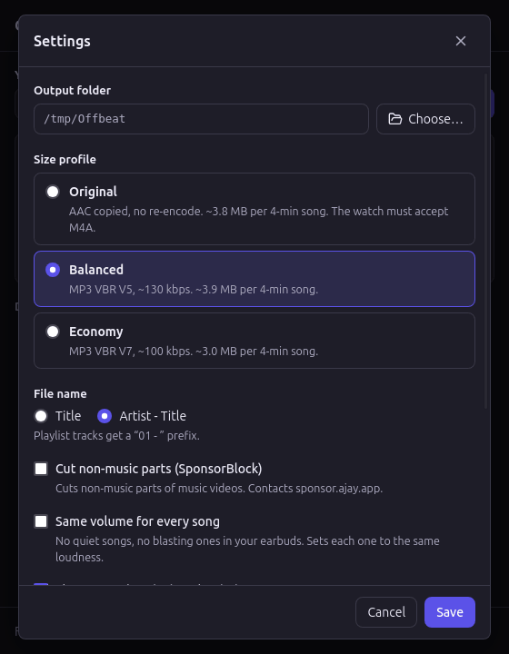

# Offbeat 🎧

**English** · [Português](README.pt-BR.md)

**Paste a YouTube or YouTube Music link, get small audio files with tags and cover art, ready for your watch.**

Offbeat is a small Linux desktop app made for one job: taking music to a smartwatch (it was built for a Huawei GT 5) to run or train without a phone. Paste the link of a song, playlist or album, and Offbeat saves each track as a compact MP3 or M4A, with title, artist, album, track number and a square cover. Then send the folder to the watch with the Huawei Health app.

Everything runs on your computer. No account, no server, no telemetry.


---

## What you can do

| | Feature | |
|---|---|---|
| 🔗 | **Paste and preview** | YouTube, YouTube Music and youtu.be links. See the cover, title, duration, number of tracks and the estimated size before downloading. Focusing the empty field pastes a link from the clipboard. |
| 💿 | **Albums and playlists** | Each track becomes its own item in the queue, numbered (`01 - `) in the file name and in the track tag. Works with YouTube Music albums and playlists. |
| 📶 | **Queue with progress** | Two downloads at a time, with progress, speed and time left. Cancel one track or all of them, retry the ones that failed. |
| 🗜️ | **Small files** | Three size profiles (below). The cover is cropped square and shrunk to 300 px (~25 KB instead of 100–300 KB per track). |
| 📁 | **Your folder** | Files go to `~/Music/Offbeat` by default (your system's music folder). The footer shows the folder total, and *Open folder* opens it when the queue ends. |
| 🌐 | **Two languages** | Português (Brasil) and English (US), following the system or chosen in Settings. Light and dark theme follow the system. |

## Size profiles

YouTube already streams audio at about 128–160 kbps. Re-encoding it as a 320 kbps MP3 only makes the file 2.5× bigger, with no gain in quality. So Offbeat either copies the original audio or encodes it once, at a similar bitrate.

| Profile | What it does | 4-min song | Tracks per 1 GB |
| --- | --- | --- | --- |
| **Original** | Copies the AAC audio as M4A, no re-encoding | ~3.8 MB | ~260 |
| **Balanced** (default) | MP3 VBR V5, ~130 kbps | ~3.9 MB | ~255 |
| **Economy** | MP3 VBR V7, ~100 kbps | ~3.0 MB | ~340 |

Original is lossless but needs a watch that plays M4A. Balanced works everywhere.



## How to use

1. Copy the link of a song, album or playlist from YouTube or YouTube Music.
2. Click the link field in Offbeat (it pastes on its own) and press **Preview**.
3. Check the preview and press **Download** (or **Download N tracks**).
4. When the queue ends, press **Open folder**.
5. Send the files to the watch with the **Huawei Health** app on your phone (Offbeat can't do this part: Huawei Health has no public API).

**Tip:** a YouTube Music link with `&list=` in it (a song played from inside an album or playlist) brings the whole list. To get only that song, remove the `&list=…` part.

## Install

There are no ready-made packages yet. To build it on Linux Mint 22 / Ubuntu 24.04:

```bash
sudo apt install build-essential curl file libwebkit2gtk-4.1-dev libxdo-dev \
  libssl-dev libayatana-appindicator3-dev librsvg2-dev
curl --proto '=https' --tlsv1.2 -sSf https://sh.rustup.rs | sh   # Rust
npm install
npm run binaries        # downloads yt-dlp, ffmpeg, ffprobe and Deno (checked with SHA-256)
npm run tauri build -- --bundles appimage
npm run install-desktop # installs for your user, no sudo
```

`install-desktop` copies the AppImage to `~/Applications/Offbeat.AppImage`, adds the `offbeat` command (`~/.local/bin`) and an **Offbeat** entry with its icon to the applications menu. To uninstall: `bash scripts/install-desktop.sh --remove` (your settings stay).

The `.deb` is not recommended yet: it installs its own `yt-dlp` and `ffmpeg` in `/usr/bin`, which clashes with the system packages of the same name. Packaging takes a few minutes, mostly compressing the bundled ffmpeg. Details in [docs/development.md](docs/development.md).

## Privacy

- Offbeat makes no network calls of its own. Only yt-dlp talks to YouTube, and to `sponsor.ajay.app` if you turn on **SponsorBlock** in Settings (it cuts the non-music parts of music videos).
- Settings live in `~/.config/offbeat/settings.json`. Temporary files go to `~/.cache/offbeat/tmp/` and are deleted after each download.
- No telemetry, crash reports or account.

## Legal note

Downloading from YouTube outside the official apps goes against YouTube's Terms of Service, even for Premium subscribers. **You are responsible for what you download.** Offbeat is not affiliated with YouTube or Google.

## Built with

[Tauri 2](https://tauri.app), React and TypeScript, with [yt-dlp](https://github.com/yt-dlp/yt-dlp), [FFmpeg](https://ffmpeg.org) and [Deno](https://deno.com) bundled as sidecars. See [NOTICE](NOTICE) for their licenses.

For developers and AI agents: start at [AGENTS.md](AGENTS.md).

## License

[MIT](LICENSE) © 2026 Matheus Andrade
