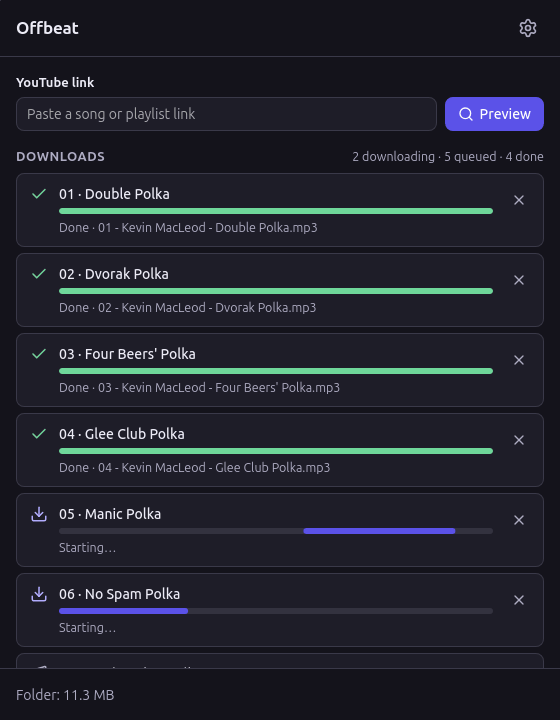
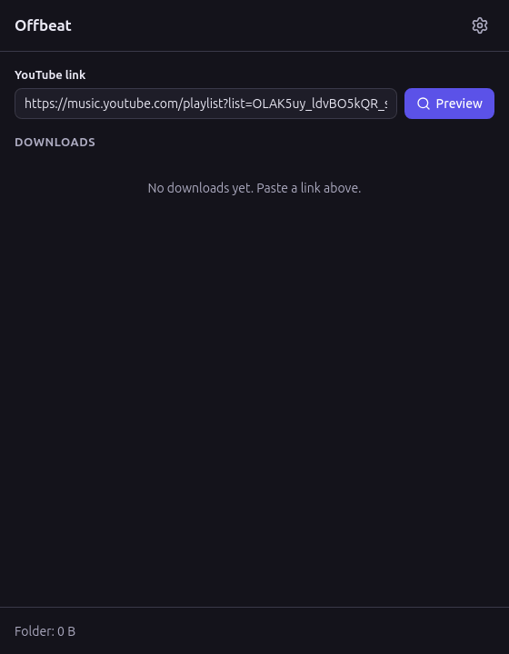
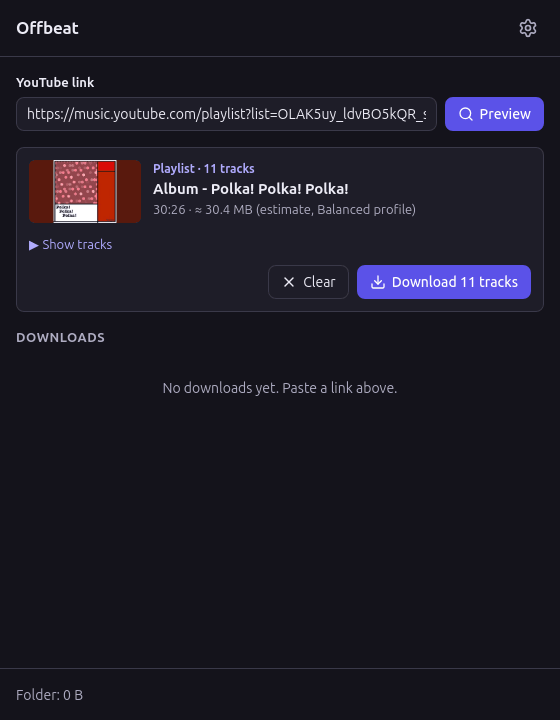
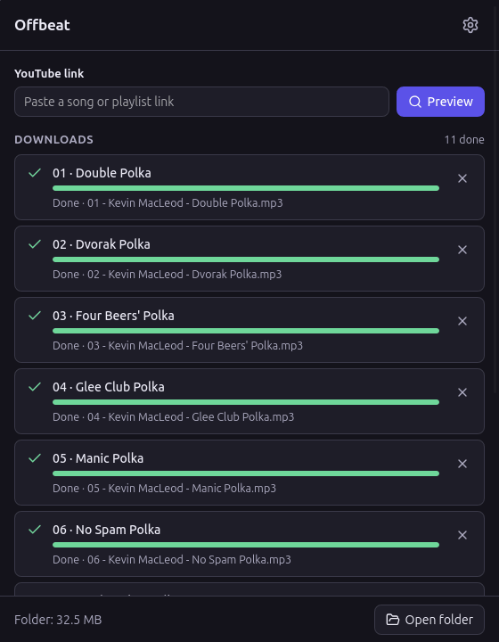

<p align="center">
  
</p>

<h1 align="center">Offbeat</h1>

<p align="center">
  <b>Your favorite songs on your watch, in three clicks.</b><br/>
  Paste a link from YouTube or <b>YouTube Music</b> and get small music files,
  with name, artist and cover, ready to send to your smartwatch.
</p>

<p align="center">
  <b>English</b> · <a href="README.pt-BR.md">Português</a>
</p>

<p align="center">
  
</p>

---

## What is this?

Imagine you want to go for a run with music, but **without carrying your phone**. Many smartwatches can play songs on their own, but you need to put the songs on the watch first. That's where Offbeat helps:

- 🔗 **You paste a link** to a song, an album or a whole playlist.
- 🎧 **Offbeat saves each song** as a small music file in a folder on your computer.
- ⌚ **You send that folder to your watch** (with the Huawei Health app, for example) and go!

Each file comes with the **song name, the artist, the album, the track number and the cover picture**, so everything looks tidy on the watch. And the files are **small**: about 1 MB per minute of music, so a lot of songs fit.

> Offbeat was made for a **Huawei Watch GT 5**, but the files are regular MP3s and work on almost any watch or music player.

---

## 🎵 Works with YouTube Music too

Yes! Albums and playlists from **YouTube Music** work just like the ones from YouTube. These are all fine:

| What you copied | Example |
| --- | --- |
| A YouTube Music **playlist** | `https://music.youtube.com/playlist?list=PL…` |
| A YouTube Music **album** | `https://music.youtube.com/playlist?list=OLAK5uy…` |
| The **album page** in YouTube Music | `https://music.youtube.com/browse/MPREb…` |
| A **single song** from YouTube Music | `https://music.youtube.com/watch?v=…` |
| A YouTube **video or playlist** | `https://www.youtube.com/watch?v=…` · `https://youtu.be/…` |

**How to copy the link in YouTube Music:** open the album or playlist, click the **⋮** (three dots) or **Share**, then **Copy link**.

Songs from YouTube Music come out especially nice: they bring the **album name** and the **square album cover**, and the songs are numbered in album order (`01 - `, `02 - `…).

> 💡 **Good to know:** if you copy a song while it's playing *inside* a playlist, the link ends with `&list=…` and Offbeat brings **the whole playlist**. Don't worry, it always shows how many songs it found before downloading anything. If you only want that one song, click **Just this track**.

### Mixes and full albums in a single video

Some long videos (running mixes, DJ sets, "full album" uploads) are split into **chapters**. When a video has chapters, the preview shows how many and the option **Split into tracks, one per chapter**. Turn it on and each chapter becomes its own song, named after the chapter and numbered, with the video's name as the album. That way you can skip songs on the watch instead of scrubbing through a one-hour file.

---

## How to use it, step by step

### 1. Paste the link

Copy the link of a song, album or playlist. In Offbeat, **click the link box**: if the link is already copied, it pastes itself. Then click **Preview**.

Want several at once? Paste **several links separated by spaces** (or copy a list, one link per line). Offbeat shows each one, and **Download all** queues them all.

<p align="center"></p>

### 2. Check what you're getting

Offbeat shows the cover, the name, how many songs there are, how long they last and **how much space they will take** (about). Click **Show tracks** to see the list. If it's right, click **Download** (or **Download 11 tracks**).

<p align="center"></p>

### 3. Wait a little

Each song gets its own line with a progress bar. Two songs download at the same time; the rest wait their turn. **Converting…** means the song is downloaded and is being turned into a small MP3. At the bottom, **Folder** shows how much space your music already takes.

Changed your mind? The **✕** on a line cancels that song, and **Cancel all** stops everything. If a song fails, the **↻** button tries again.

<p align="center"></p>

### 4. Open the folder

When everything is done, click **Open folder**. Your songs are there, ready.

<p align="center"></p>

### 5. Send to the watch

Copy the songs to your phone (with a USB cable, for example) and add them to the watch with your watch's app. On the **Huawei Health** app, open your watch, go to **Music** and add the songs (the menu names can change a bit between versions). Offbeat can't do this part for you: Huawei doesn't allow other apps to send music to the watch.

---

## ⚙️ Settings

Click the **gear** at the top right.

<p align="center"></p>

- **Output folder:** where the songs are saved. By default, an `Offbeat` folder inside your **Music** folder.
- **Size profile:** how small the files are. If you're not sure, keep **Balanced**.

  | Profile | Good for | A 4-minute song | Songs in 1 GB |
  | --- | --- | --- | --- |
  | **Original** | Best quality, if your watch plays M4A files | ~3.8 MB | ~260 |
  | **Balanced** ⭐ | Everyone (MP3 works everywhere) | ~3.9 MB | ~255 |
  | **Economy** | Fitting more songs | ~3.0 MB | ~340 |

- **File name:** just the song title, or *Artist - Title*. Songs from albums and playlists also get their number in front (`01 - `).
- **Cut non-music parts (SponsorBlock):** removes talking and intros from music videos. To do this, Offbeat asks a free community service (`sponsor.ajay.app`) where those parts are. Off by default.
- **Same volume for every song:** evens out the loudness, so no song is too quiet or blasting in your earbuds. Great for working out. Off by default; not available with the Original profile, which keeps the audio untouched.
- **Skip songs already downloaded:** Offbeat remembers what it downloaded. Open a playlist that grew and it shows how many came before, and **Download N new** brings only the new ones, even if you deleted the files after sending them to the watch. On by default. Want one again? **Download again** in the preview, or **↻** in the queue. **Clear history** makes Offbeat forget everything.
- **Language:** Português (Brasil) or English (US). *System* follows your computer.

---

## Install

### If someone gave you the `Offbeat.AppImage` file

1. Put the file somewhere safe, like your **Applications** or **Home** folder.
2. Right-click it → **Properties** → **Permissions** → tick **Allow executing file as program**.
3. Double-click it. That's it! 🎉

### If you're setting it up from the code

On Linux Mint 22 or Ubuntu 24.04, in a terminal (it takes about 10 minutes the first time, mostly packing the music tools inside the app):

```bash
sudo apt update
sudo apt install build-essential curl file libwebkit2gtk-4.1-dev libxdo-dev \
  libssl-dev libayatana-appindicator3-dev librsvg2-dev
curl --proto '=https' --tlsv1.2 -sSf https://sh.rustup.rs | sh   # Rust
npm install
npm run binaries                            # downloads yt-dlp, ffmpeg and Deno (checked)
npm run tauri build -- --bundles appimage   # builds Offbeat.AppImage
npm run install-desktop                     # puts Offbeat in the app menu (no sudo)
```

After that, open **Offbeat** from the applications menu. To remove it: `bash scripts/install-desktop.sh --remove`. More details in [docs/development.md](docs/development.md).

---

## Questions

**Is it free? Do I need an account?**
Free, no account, no sign-up, no ads.

**Does it send my data anywhere?**
No. Offbeat runs on your computer. The only thing that goes to the internet is the download itself, from YouTube (and SponsorBlock, if you turn it on). No tracking of any kind.

**Do I need YouTube Premium?**
No. But note that YouTube's rules don't allow downloading outside its own apps, even for Premium users. **You are responsible for what you download.** Prefer music you have the right to keep, like your own uploads or songs with a free license (Creative Commons).

**Can I download private playlists or my "Liked music"?**
Not yet: those need a login, and Offbeat only downloads public content for now.

**How much music fits on my watch?**
With the Balanced profile, about **255 songs per GB**. The footer shows the folder size so you can compare it with the free space your watch app shows.

---

## If something goes wrong

| Message | What to do |
| --- | --- |
| *YouTube is blocking anonymous access* | Wait a while and try again. If it keeps happening, Offbeat needs a newer yt-dlp (ask whoever installed it). |
| *This content requires sign-in* | The video or playlist is private or for members only. |
| *Video unavailable* | It was removed, or it's blocked in your country. |
| *Cannot reach YouTube* | Check your internet. |
| *YouTube refused the download (HTTP 403)* | Offbeat needs a newer yt-dlp. |

Every error has a **Details** link with the original message, handy if you ask someone for help.

---

## For the curious and for developers

Offbeat is built with [Tauri 2](https://tauri.app), React and TypeScript, and uses [yt-dlp](https://github.com/yt-dlp/yt-dlp), [FFmpeg](https://ffmpeg.org) and [Deno](https://deno.com), which come inside the app (licenses in [NOTICE](NOTICE)). Start at [AGENTS.md](AGENTS.md) for how the code is organized. The screenshots use *Polka! Polka! Polka!* by Kevin MacLeod (incompetech.com), licensed under Creative Commons: By Attribution 4.0.

## Legal

- **Use it for what you have the right to keep:** your own uploads, works in the public domain or under a license that allows it (such as Creative Commons), or what the law of your country lets you copy for personal use. You are responsible for what you download and for following the terms of the services you use.
- **Offbeat doesn't break protections.** It doesn't bypass DRM, doesn't use logins or cookies, and doesn't download encrypted or subscriber-only content. It only downloads what anyone can watch without signing in.
- **Trademarks.** YouTube and YouTube Music are trademarks of Google LLC. Huawei, Huawei Health and HUAWEI WATCH GT are trademarks of Huawei Technologies Co., Ltd. Offbeat is an independent project, not affiliated with or endorsed by Google or Huawei; the names only say what it works with.
- **Third-party programs.** The app ships yt-dlp (Unlicense), FFmpeg (GPL v3) and Deno (MIT) unmodified. Their licenses, and those of the libraries it uses, come inside the app in the `licenses` folder. The details, including where to find the FFmpeg source code, are in [NOTICE](NOTICE).

## License

[MIT](LICENSE) © 2026 Matheus Andrade
