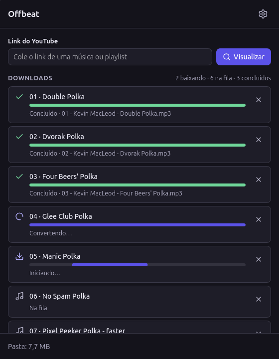
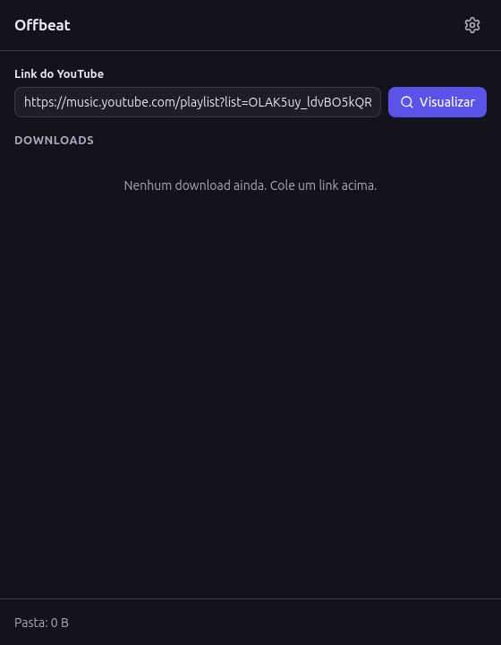
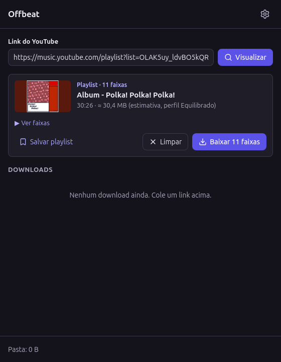
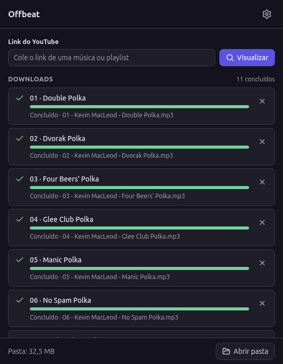
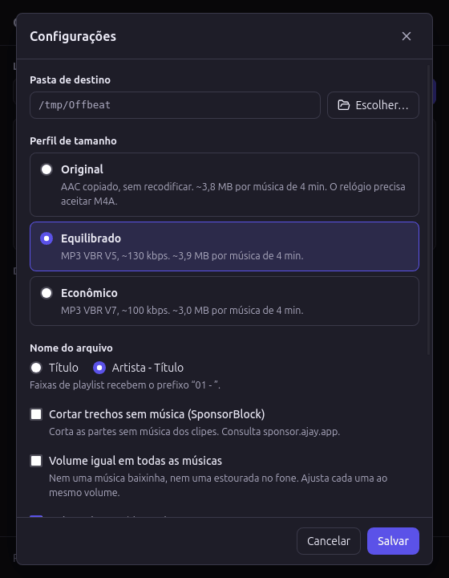

<p align="center">
  
</p>

<h1 align="center">Offbeat</h1>

<p align="center">
  <b>Suas músicas favoritas no relógio, em três cliques.</b><br/>
  Cole um link do YouTube ou do <b>YouTube Music</b> e receba arquivos de música pequenos,
  com nome, artista e capa, prontos para mandar para o seu smartwatch.
</p>

<p align="center">
  <b>Português</b> · <a href="README.md">English</a>
</p>

<p align="center">
  
</p>

---

## O que é isso?

Imagine que você quer sair para correr com música, mas **sem levar o celular**. Muitos relógios inteligentes tocam música sozinhos, mas antes é preciso colocar as músicas neles. É aí que o Offbeat ajuda:

- 🔗 **Você cola um link** de uma música, de um álbum ou de uma playlist inteira.
- 🎧 **O Offbeat salva cada música** como um arquivo pequeno numa pasta do seu computador.
- ⌚ **Você manda essa pasta para o relógio** (pelo app Huawei Health, por exemplo) e pronto!

Cada arquivo vem com **nome da música, artista, álbum, número da faixa e a capa**, então tudo aparece organizado no relógio. E os arquivos são **pequenos**: cerca de 1 MB por minuto de música, então cabe muita coisa.

> O Offbeat foi feito para um **Huawei Watch GT 5**, mas os arquivos são MP3 comuns e funcionam em quase qualquer relógio ou tocador de música.

---

## 🎵 Funciona com o YouTube Music também

Sim! Álbuns e playlists do **YouTube Music** funcionam igualzinho aos do YouTube. Todos estes servem:

| O que você copiou | Exemplo |
| --- | --- |
| Uma **playlist** do YouTube Music | `https://music.youtube.com/playlist?list=PL…` |
| Um **álbum** do YouTube Music | `https://music.youtube.com/playlist?list=OLAK5uy…` |
| A **página do álbum** no YouTube Music | `https://music.youtube.com/browse/MPREb…` |
| **Uma música** do YouTube Music | `https://music.youtube.com/watch?v=…` |
| Um **vídeo ou playlist** do YouTube | `https://www.youtube.com/watch?v=…` · `https://youtu.be/…` |

**Como copiar o link no YouTube Music:** abra o álbum ou a playlist, clique nos **⋮** (três pontinhos) ou em **Compartilhar** e depois em **Copiar link**.

As músicas do YouTube Music saem especialmente caprichadas: vêm com o **nome do álbum** e a **capa quadrada do álbum**, e ficam numeradas na ordem do disco (`01 - `, `02 - `…).

> 💡 **Bom saber:** se você copiar uma música enquanto ela toca *dentro* de uma playlist, o link termina com `&list=…` e o Offbeat traz **a playlist inteira**. Fique tranquilo: ele sempre mostra quantas músicas encontrou antes de baixar qualquer coisa. Se quiser só aquela música, clique em **Só esta faixa**.

### Mixes e álbuns num vídeo só

Alguns vídeos longos (mixes para correr, sets de DJ, "álbum completo") vêm divididos em **capítulos**. Quando o vídeo tem capítulos, a pré-visualização mostra quantos são e a opção **Dividir em faixas, uma por capítulo**. Ligada, cada capítulo vira uma música separada, com o nome do capítulo e numerada, e o nome do vídeo vira o álbum. Assim dá para pular de música no relógio em vez de arrastar um arquivo de uma hora.

---

## Como usar, passo a passo

### 1. Cole o link

Copie o link de uma música, álbum ou playlist. No Offbeat, **clique na caixa do link**: se o link já estiver copiado, ele se cola sozinho. Depois clique em **Visualizar**.

Quer baixar vários de uma vez? Cole **vários links separados por espaço** (ou copie uma lista, um link por linha). O Offbeat mostra cada um e o botão **Baixar tudo** põe todos na fila.

<p align="center"></p>

### 2. Confira o que vai baixar

O Offbeat mostra a capa, o nome, quantas músicas são, quanto tempo duram e **quanto espaço vão ocupar** (mais ou menos). Clique em **Ver faixas** para ver a lista. Se estiver certo, clique em **Baixar** (ou **Baixar 11 faixas**).

<p align="center"></p>

### 3. Espere um pouquinho

Cada música ganha uma linha com uma barra de progresso. Duas músicas baixam ao mesmo tempo; as outras esperam a vez. **Convertendo…** quer dizer que a música já baixou e está virando um MP3 pequeno. Embaixo, **Pasta** mostra quanto espaço suas músicas já ocupam.

Mudou de ideia? O **✕** de uma linha cancela aquela música, e **Cancelar tudo** para tudo. Se uma música falhar, o botão **↻** tenta de novo.

<p align="center"></p>

### 4. Abra a pasta

Quando tudo terminar, clique em **Abrir pasta**. Suas músicas estão lá, prontas.

<p align="center"></p>

### 5. Mande para o relógio

Copie as músicas para o celular (com um cabo USB, por exemplo) e adicione-as ao relógio pelo app do relógio. No **Huawei Health**, abra o seu relógio, vá em **Música** e adicione as músicas (os nomes dos menus podem mudar um pouco entre versões). Essa parte o Offbeat não consegue fazer por você: a Huawei não deixa outros apps mandarem música para o relógio.

---

## ⚙️ Configurações

Clique na **engrenagem** no canto de cima, à direita.

<p align="center"></p>

- **Pasta de destino:** onde as músicas são salvas. Por padrão, uma pasta `Offbeat` dentro da sua pasta de **Música**.
- **Perfil de tamanho:** o quanto os arquivos ficam pequenos. Na dúvida, deixe em **Equilibrado**.

  | Perfil | Bom para | Música de 4 min | Músicas em 1 GB |
  | --- | --- | --- | --- |
  | **Original** | Melhor qualidade, se o seu relógio toca arquivos M4A | ~3,8 MB | ~260 |
  | **Equilibrado** ⭐ | Todo mundo (MP3 funciona em qualquer lugar) | ~3,9 MB | ~255 |
  | **Econômico** | Caber mais músicas | ~3,0 MB | ~340 |

- **Nome do arquivo:** só o título da música, ou *Artista - Título*. Músicas de álbuns e playlists também ganham o número na frente (`01 - `).
- **Cortar trechos sem música (SponsorBlock):** tira conversas e introduções dos clipes. Para isso, o Offbeat pergunta a um serviço gratuito da comunidade (`sponsor.ajay.app`) onde ficam esses trechos. Vem desligado.
- **Volume igual em todas as músicas:** deixa todas com o mesmo volume, sem uma baixinha e outra estourando no fone. Ótimo para treinar. Vem desligado; não vale para o perfil Original, que guarda o áudio intacto.
- **Pular músicas já baixadas:** o Offbeat lembra o que já baixou. Ao abrir de novo uma playlist que cresceu, ele mostra quantas já vieram antes e o botão **Baixar N novas** traz só as novas. Mesmo que você já tenha apagado os arquivos depois de mandar para o relógio. Vem ligado. Quer uma de novo? **Baixar de novo** na pré-visualização, ou o **↻** na fila. **Apagar histórico** faz o Offbeat esquecer tudo.
- **Idioma:** Português (Brasil) ou English (US). *Sistema* segue o seu computador.

---

## Instalar

### Se alguém te passou o arquivo `Offbeat.AppImage`

1. Guarde o arquivo num lugar seguro, como a pasta **Aplicativos** ou a sua **Pasta pessoal**.
2. Clique com o botão direito → **Propriedades** → **Permissões** → marque **Permitir execução do arquivo como programa**.
3. Clique duas vezes nele. Pronto! 🎉

### Se você vai montar a partir do código

No Linux Mint 22 ou Ubuntu 24.04, num terminal (leva uns 10 minutos na primeira vez, quase tudo empacotando as ferramentas de música dentro do app):

```bash
sudo apt update
sudo apt install build-essential curl file libwebkit2gtk-4.1-dev libxdo-dev \
  libssl-dev libayatana-appindicator3-dev librsvg2-dev
curl --proto '=https' --tlsv1.2 -sSf https://sh.rustup.rs | sh   # Rust
npm install
npm run binaries                            # baixa yt-dlp, ffmpeg e Deno (conferidos)
npm run tauri build -- --bundles appimage   # gera o Offbeat.AppImage
npm run install-desktop                     # põe o Offbeat no menu de aplicativos (sem sudo)
```

Depois, abra o **Offbeat** pelo menu de aplicativos. Para remover: `bash scripts/install-desktop.sh --remove`. Mais detalhes em [docs/development.md](docs/development.md).

---

## Dúvidas

**É de graça? Preciso de conta?**
De graça, sem conta, sem cadastro e sem anúncios.

**Ele manda meus dados para algum lugar?**
Não. O Offbeat roda no seu computador. A única coisa que vai para a internet é o próprio download, do YouTube (e do SponsorBlock, se você ligar). Nenhum tipo de rastreamento.

**Preciso do YouTube Premium?**
Não. Mas saiba que as regras do YouTube não permitem baixar fora dos apps dele, nem para assinantes Premium. **Você é responsável pelo que baixa.** Prefira músicas que você tem o direito de guardar, como envios seus ou músicas com licença livre (Creative Commons).

**Dá para baixar playlists privadas ou as "Músicas curtidas"?**
Ainda não: elas exigem login, e por enquanto o Offbeat só baixa conteúdo público.

**Quanta música cabe no meu relógio?**
No perfil Equilibrado, cerca de **255 músicas por GB**. O rodapé mostra o tamanho da pasta, para você comparar com o espaço livre que o app do relógio mostra.

---

## Se algo der errado

| Mensagem | O que fazer |
| --- | --- |
| *O YouTube está bloqueando o acesso anônimo* | Espere um pouco e tente de novo. Se continuar, o Offbeat precisa de um yt-dlp mais novo (fale com quem instalou). |
| *Este conteúdo exige login* | O vídeo ou a playlist é privado ou só para membros. |
| *Vídeo indisponível* | Foi removido ou está bloqueado no seu país. |
| *Sem conexão com o YouTube* | Confira a sua internet. |
| *O YouTube recusou o download (HTTP 403)* | O Offbeat precisa de um yt-dlp mais novo. |

Todo erro tem um link **Detalhes** com a mensagem original, útil se você pedir ajuda a alguém.

---

## Para curiosos e desenvolvedores

O Offbeat é feito com [Tauri 2](https://tauri.app), React e TypeScript, e usa o [yt-dlp](https://github.com/yt-dlp/yt-dlp), o [FFmpeg](https://ffmpeg.org) e o [Deno](https://deno.com), que vão dentro do app (licenças em [NOTICE](NOTICE)). Comece pelo [AGENTS.md](AGENTS.md) para entender como o código é organizado. As capturas de tela usam *Polka! Polka! Polka!*, de Kevin MacLeod (incompetech.com), licenciado em Creative Commons: By Attribution 4.0.

## Aviso legal

- **Use para o que você tem direito de guardar:** envios seus, obras em domínio público ou com licença que permita (como Creative Commons), ou o que a lei do seu país permite copiar para uso pessoal. Você é responsável pelo que baixa e por seguir as regras dos serviços que usa.
- **O Offbeat não quebra proteções.** Ele não contorna DRM, não usa login nem cookies e não baixa conteúdo criptografado ou exclusivo para assinantes. Só baixa o que qualquer pessoa consegue assistir sem entrar na conta.
- **Marcas.** YouTube e YouTube Music são marcas da Google LLC. Huawei, Huawei Health e HUAWEI WATCH GT são marcas da Huawei Technologies Co., Ltd. O Offbeat é um projeto independente, sem relação com o Google nem com a Huawei, nem apoio deles; os nomes aparecem só para dizer com o que ele funciona.
- **Programas de terceiros.** O app leva o yt-dlp (Unlicense), o FFmpeg (GPL v3) e o Deno (MIT) sem modificações. As licenças deles e das bibliotecas usadas vão dentro do app, na pasta `licenses`. Os detalhes, incluindo onde achar o código-fonte do FFmpeg, estão no [NOTICE](NOTICE).

## Licença

[MIT](LICENSE) © 2026 Matheus Andrade
