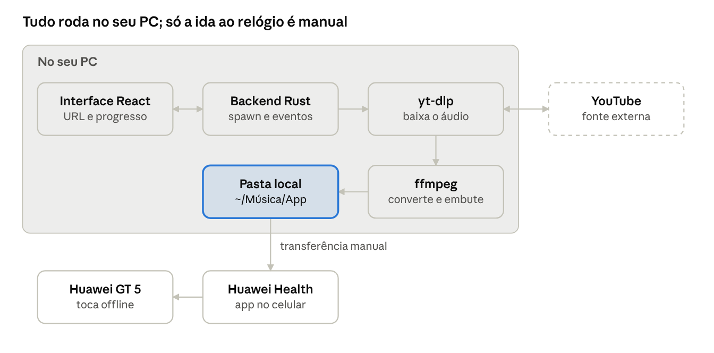
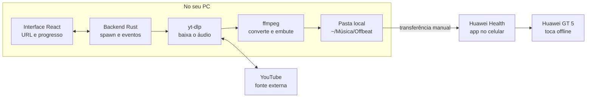

# Offbeat — app desktop de download de áudio com yt-dlp

Documentação de planejamento · 6 de novembro de 2026

> Documento original de planejamento, mantido como registro e não atualizado. O estado atual está no [ROADMAP](../ROADMAP.md) e as decisões que mudaram na implementação em [architecture.md](architecture.md#decisões-que-mudaram-em-relação-ao-planejamento).

## Visão geral

Um app desktop pequeno para Linux: você cola a URL de uma música ou playlist, ele chama o yt-dlp e salva o áudio com metadados numa pasta local, pronta para ir ao relógio pelo Huawei Health. Tudo roda na máquina, sem servidor, conta ou telemetria.

**Escopo do MVP**

- Um campo de URL, um botão Baixar e uma lista de downloads com progresso.
- Saída em M4A ou MP3 com título, artista, álbum e capa embutidos.
- Pasta de destino configurável, por padrão `~/Música/Offbeat`.
- Suporte a vídeo único e playlist.

**Fora do escopo do MVP**

- Envio direto para o relógio: o Huawei Health não tem API pública, então a transferência continua manual.
- Vídeo, legendas e outros sites além do YouTube e do YouTube Music (o yt-dlp suporta, mas não é o foco).
- Login próprio: quando precisar de sessão, o app usa os cookies do navegador.

## Stack recomendada

A recomendação é **Tauri 2 + React + TypeScript**: você reaproveita o que já sabe de React, e o binário fica bem menor que o do Electron porque usa o WebView do sistema. O backend em Rust só lança processos e lê a saída, então dá para escrever pouco Rust.

| Opção | Tamanho do pacote | Curva para você | Quando escolher |
| --- | --- | --- | --- |
| Tauri 2 + React | ~10 MB (sem yt-dlp/ffmpeg) | Baixa no front, média no Rust | Padrão: leve, moderno, bom para publicar |
| Electron + React | ~100 MB ou mais | Nenhuma (tudo Node) | Para prototipar rápido usando `child_process` |
| Python + PySide6 | ~60 MB com PyInstaller | Média | Para usar o yt-dlp como biblioteca Python em vez de binário |

Tamanhos aproximados, de memória, sem medição.

**Bibliotecas úteis no Tauri**

- `@tauri-apps/plugin-shell`: roda yt-dlp e ffmpeg como sidecars.
- `@tauri-apps/plugin-dialog`: seletor da pasta de destino.
- `@tauri-apps/plugin-store`: guarda as configurações em JSON local.
- `@tauri-apps/plugin-opener`: botão "Abrir pasta".
- UI: Tailwind + shadcn/ui, ou CSS simples, porque a tela é uma só.

## Arquitetura





O React só conversa com o backend Rust por comandos e eventos do Tauri. Só o backend lança processos. Fluxo de um download:

1. Você cola a URL; o front chama o comando `preview` e o backend roda `yt-dlp -J`.
2. Você confirma; o comando `download` lança o yt-dlp com os argumentos do perfil escolhido.
3. O backend lê o stdout linha a linha e envia os eventos `progress` e `done` ao front.
4. O yt-dlp chama o ffmpeg para converter (ou só trocar o contêiner) e embutir metadados e capa.
5. O arquivo cai na pasta local e dali vai para o relógio pelo Huawei Health.

## Funcionalidades

O MVP cabe em uma tela. O resto entra depois que o fluxo básico estiver estável.

**MVP**

- [ ] Campo de URL com validação (youtube.com, youtu.be, music.youtube.com) e colagem automática da área de transferência ao focar.
- [ ] Pré-visualização: título, capa, duração e número de faixas, antes de baixar.
- [ ] Fila de downloads com barra de progresso por faixa, velocidade e tempo restante.
- [ ] Cancelar um item ou a fila inteira.
- [ ] Saída M4A ou MP3 com metadados e capa embutidos.
- [ ] Configurações: pasta de destino, perfil de tamanho (Original, Equilibrado, Econômico) e padrão de nome do arquivo.
- [ ] Botão "Abrir pasta" ao terminar.

**Depois do MVP**

- [ ] Arquivo de histórico (`--download-archive`) para não baixar de novo o que já existe. Útil para sincronizar uma playlist que cresce.
- [ ] "Playlists salvas": um clique para buscar só as faixas novas.
- [ ] Cookies do navegador (Firefox/Chrome) para playlists privadas.
- [ ] Normalização de volume (filtro `loudnorm` do ffmpeg), útil para treinar com fone.
- [ ] Limite de tamanho: avisar quando a pasta passar do espaço livre no relógio.
- [ ] Atualizar o yt-dlp pelo próprio app.
- [ ] Tema claro/escuro seguindo o sistema.

## Integração com yt-dlp

O app faz duas chamadas: uma para ler os metadados e montar a pré-visualização, outra para baixar, lendo o progresso linha a linha. Passe sempre os argumentos como lista (nunca como string de shell) e coloque `--` antes da URL, para que nada que o usuário cole vire opção ou comando.

**1. Metadados (pré-visualização)**

```bash
yt-dlp -J --flat-playlist -- "<URL>"
```

Devolve um JSON. Se `_type` for `playlist`, o array `entries` traz `id`, `title` e `duration` de cada faixa, sem baixar nada. Para vídeo único, use `title`, `uploader`, `duration` e `thumbnail`.

**2. Download**

```bash
yt-dlp \
  -x --audio-format mp3 --audio-quality 5 \
  --embed-metadata --embed-thumbnail --convert-thumbnails jpg \
  --ffmpeg-location "<caminho do ffmpeg empacotado>" \
  -P "<pasta de destino>" \
  -o "%(playlist_index)02d - %(title)s.%(ext)s" \
  --newline --progress \
  --progress-template "download:PROG %(progress)j" \
  --print "after_move:DONE %(filepath)s" \
  -- "<URL>"
```

- Para vídeo único, troque o `-o` por `%(title)s.%(ext)s`. O app escolhe com base na resposta do passo 1.
- Linhas que começam com `PROG` são JSON: use `downloaded_bytes`, `total_bytes` (ou `total_bytes_estimate`), `speed` e `eta` para a barra de progresso.
- Linhas `DONE` trazem o caminho final do arquivo: marque a faixa como concluída.
- Após o download, o ffmpeg converte o áudio. Mostre "Convertendo…" nesse intervalo, porque o progresso fica parado em 100%.
- Os argumentos de formato e qualidade variam por perfil (veja "Compactação para o relógio").

**Cancelamento**

Envie SIGTERM ao processo e depois apague os `.part` e `.ytdl` que sobrarem na pasta de destino.

**Erros comuns**

| Mensagem no stderr | Causa provável | O que o app faz |
| --- | --- | --- |
| `Sign in to confirm you're not a bot` | YouTube bloqueando acesso anônimo | Sugere usar cookies do navegador e atualizar o yt-dlp |
| `Private video` / `members-only` | Conteúdo exige login | Oferece `--cookies-from-browser firefox` |
| `ffmpeg not found` | Caminho do sidecar errado | Erro de instalação, mostrar o caminho testado |
| `HTTP Error 403` | yt-dlp desatualizado | Botão "Atualizar yt-dlp" |

No YouTube, versões recentes do yt-dlp pedem um runtime JavaScript externo (como o Deno) para resolver os desafios do player. Confira o README da versão que for empacotar e inclua o runtime como sidecar, se for o caso.

## Compactação para o relógio

O ganho maior vem de não recomprimir: o YouTube já entrega o áudio em AAC ou Opus a cerca de 128–160 kbps. Converter isso para MP3 de 320 kbps só aumenta o arquivo em ~2,5×, sem recuperar nenhuma qualidade. A regra é ou copiar o áudio original sem recodificar, ou fazer uma única codificação a partir da melhor fonte, numa taxa parecida com a original.

**Etapas do pipeline**

1. **Fonte limpa.** Prefira links do music.youtube.com (faixa de áudio, sem introdução de clipe) e adicione `--sponsorblock-remove music_offtopic`, que corta trechos sem música dos clipes, como introduções e cenas faladas.
2. **Sem recodificação, quando possível (perfil Original).** Se o relógio aceitar M4A/AAC, use `-f "bestaudio[ext=m4a]/bestaudio" -x --audio-format m4a`. Quando a fonte já é AAC, o yt-dlp só troca o contêiner: perda zero, ~1 MB por minuto.
3. **Uma única codificação MP3 (perfil Equilibrado).** Se o relógio só aceitar MP3, use `-f bestaudio -x --audio-format mp3 --audio-quality 5`, que é VBR V5 do LAME, em torno de 130 kbps. Nunca converta MP3 para MP3.
4. **Modo econômico (opcional).** `--audio-quality 7` (~100 kbps). Se usar só um fone, acrescente mono com `--ppa "ExtractAudio+ffmpeg_o:-ac 1"`, que reduz mais o tamanho. Como esse perfil recodifica, a diferença costuma ser audível apenas em fone bom.
5. **Volume uniforme na mesma passada.** Se for recodificar de qualquer jeito, aplique `-af loudnorm=I=-14:TP=-1` no mesmo `--ppa`. Assim a normalização sai de graça, sem uma segunda perda.
6. **Capa pequena.** Uma capa embutida tem de 100 a 300 KB por faixa. Reduza para 300 px com `--ppa "ThumbnailsConvertor+ffmpeg_o:-vf scale=300:-1 -q:v 5"` (~20–30 KB), ou desligue `--embed-thumbnail` se o relógio não mostrar a capa.
7. **Conferir o espaço.** Depois de cada lote, o app soma o tamanho da pasta e compara com o espaço livre que o Huawei Health mostra para o relógio.

**Tamanho por perfil**

| Perfil | Configuração | MB por minuto | Música de 4 min | Faixas por 1 GB |
| --- | --- | --- | --- | --- |
| Original | AAC copiado, ~128 kbps | ~0,96 | ~3,8 MB | ~260 |
| Equilibrado | MP3 VBR V5, ~130 kbps | ~1,0 | ~3,9 MB | ~255 |
| Econômico | MP3 VBR V7, ~100 kbps | ~0,75 | ~3,0 MB | ~340 |
| Econômico mono | MP3 V7 mono | ~0,5 | ~2,0 MB | ~500 |
| Evitar | MP3 320 kbps | ~2,4 | ~9,6 MB | ~105 |

Valores calculados a partir da taxa de bits; o VBR varia de faixa para faixa. O valor de mono é uma estimativa.

**Pendência:** testar se o GT 5 toca M4A transferido pelo Huawei Health. Se tocar, Original vira o perfil padrão; se não, o padrão é Equilibrado.

## Estrutura do projeto

O frontend React fica em `src/`, o backend Rust em `src-tauri/`, e os binários externos em `src-tauri/binaries/`, com o sufixo da plataforma que o Tauri exige.

```text
offbeat/
├─ src/                      # React + TypeScript
│  ├─ components/
│  │  ├─ UrlInput.tsx         # campo de URL + botão Baixar
│  │  ├─ Preview.tsx          # capa, título, nº de faixas
│  │  ├─ Queue.tsx            # lista com progresso por faixa
│  │  └─ Settings.tsx         # pasta, perfil de tamanho, cookies
│  ├─ lib/
│  │  ├─ ytdlp.ts             # monta os argumentos por perfil
│  │  └─ progress.ts          # interpreta linhas PROG / DONE
│  └─ App.tsx
├─ src-tauri/
│  ├─ src/
│  │  ├─ main.rs
│  │  └─ downloads.rs         # spawn, cancelamento, eventos para o front
│  ├─ binaries/
│  │  ├─ yt-dlp-x86_64-unknown-linux-gnu
│  │  └─ ffmpeg-x86_64-unknown-linux-gnu
│  ├─ capabilities/default.json  # libera só os sidecars e os plugins usados
│  └─ tauri.conf.json
├─ docs/
│  └─ arquitetura.png
└─ package.json
```

Em `capabilities/default.json`, permita apenas a execução dos dois sidecars com argumentos validados, em vez de liberar o shell inteiro.

## Empacotamento e distribuição

No Linux, `npm run tauri build` gera AppImage, .deb e .rpm. Para uso próprio, o AppImage resolve: é um arquivo só, que roda sem instalação.

**Binários empacotados**

- **yt-dlp:** use o executável autônomo `yt-dlp_linux` dos releases do GitHub do projeto, que não depende do Python do sistema. Renomeie com o sufixo da plataforma (veja a estrutura acima).
- **ffmpeg:** use um build estático com `libmp3lame`. Os builds mantidos pelo próprio yt-dlp (`yt-dlp/FFmpeg-Builds`) já trazem as correções que ele espera.
- **Runtime JS:** se a versão do yt-dlp pedir, inclua o Deno como terceiro sidecar.

**Atualizar o yt-dlp**

O YouTube muda com frequência, e um yt-dlp antigo para de funcionar em semanas. Dentro do AppImage o binário é somente leitura, então:

1. O botão "Atualizar" baixa o release mais recente para `~/.local/share/offbeat/bin/yt-dlp`.
2. O app usa esse binário quando ele existe, e o empacotado como reserva.
3. Confira o SHA-256 do download com o arquivo `SHA2-256SUMS` publicado no mesmo release.

**Licenças**

| Componente | Licença | Implicação |
| --- | --- | --- |
| yt-dlp | Unlicense (domínio público) | Nenhuma restrição |
| ffmpeg | LGPL ou GPL, conforme o build | Se publicar o app, inclua a licença e um link para o código-fonte do build |
| Tauri | MIT / Apache-2.0 | Manter os avisos |

Para uso pessoal, nada disso exige ação. Só passa a importar se você publicar o app.

## Privacidade e considerações legais

O app não faz nenhuma chamada de rede própria: os únicos acessos são os do yt-dlp para o YouTube e, quando o usuário pede, a verificação de atualização no GitHub.

**Privacidade**

- Sem telemetria, sem relatório de falhas automático, sem conta.
- Configurações e histórico ficam em `~/.config/offbeat/` e `~/.local/share/offbeat/`.
- Cookies: use `--cookies-from-browser` na hora do download, sem copiar nem guardar os cookies no app. Se algum dia precisar de arquivo de cookies, salve com permissão `600`.
- CSP restritiva no `tauri.conf.json`: o WebView só carrega recursos locais e as capas do domínio `i.ytimg.com`.

**Legal**

- Baixar do YouTube fora do app oficial viola os Termos de Serviço, mesmo para assinantes Premium.
- A Lei 9.610/98 não prevê de forma clara a cópia privada integral. Uso pessoal sem venda continua sendo zona cinzenta.
- Se publicar o código, não use "YouTube" no nome nem o logotipo, e deixe claro no README que o usuário é responsável pelo que baixa. É o que fazem projetos como o Seal e o yt-dlp.

## Sugestões de nome

Nome adotado: **Offbeat** (nome da pasta do projeto). As alternativas avaliadas ficam abaixo para referência.

| Nome | O que evoca | Observação |
| --- | --- | --- |
| Pulso | Pulso (relógio), batida, frequência cardíaca | Palavra comum, verifique o nome do pacote |
| Compacto | Disco compacto de vinil, arquivo pequeno | Bom se o foco for a compactação |
| Cadência | Ritmo da corrida e da música | Combina com o uso para correr |
| Fôlego | Treino, resistência | Soa bem, menos ligado a música |
| Faixa | Faixa de música, raia da pista | Simples, mas genérico para buscar |
| Bolso | Música de bolso, offline | Leve e informal |
| Wristwave | Wrist + wave, em inglês | Se quiser publicar para público internacional |
| Tinytunes | Músicas pequenas | Inglês, descritivo, bem-humorado |

Não pesquisei se esses nomes (incluindo Offbeat) já existem. Antes de publicar, procure no GitHub, no Flathub e no INPI. Evite qualquer nome com "YouTube" ou "YT", que são marcas do Google.

## Roadmap

Comece pelo teste no relógio. Ele define o formato padrão e evita construir o app em cima de uma suposição.

1. **Prova no terminal.** Baixe 3 faixas no perfil Original (M4A) e 3 no Equilibrado (MP3 V5), mande pelo Huawei Health e confira se tocam, se mostram título e capa, e quanto espaço ocupam.
2. **Esqueleto Tauri.** `npm create tauri-app`, com React + TS, sidecars do yt-dlp e do ffmpeg configurados e uma chamada `--version` funcionando.
3. **Download único.** Campo de URL, um download com progresso e o arquivo salvo na pasta escolhida.
4. **Playlist e fila.** Pré-visualização com `-J`, fila com progresso por faixa e cancelamento.
5. **Perfis de tamanho.** Original, Equilibrado e Econômico, capa reduzida, SponsorBlock e o total da pasta em MB.
6. **Sincronização.** `--download-archive`, playlists salvas e baixar só as faixas novas.
7. **Manutenção.** Atualização do yt-dlp pelo app e build AppImage.
